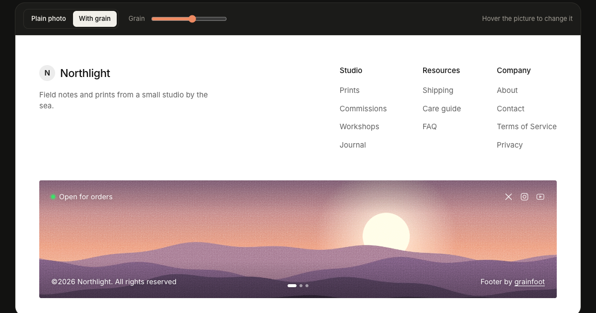

# grainfoot

A drop-in website footer whose image band gets a grainy, matte print effect. You list your image paths in one config array.

Live: https://grainfoot.vercel.app · Playground: https://grainfoot.vercel.app/app

The layout follows a footer design that Faris ([@Faris_rzk](https://x.com/Faris_rzk)) posted on X. It's rebuilt here from scratch in code, with our own images and a placeholder brand. If you want a custom footer or site designed properly, [hire him](https://x.com/Faris_rzk).



## Use it

**React / Next.js.** Copy [`components/GrainFooter.tsx`](components/GrainFooter.tsx) into your project. It's one file and needs nothing besides React. Put your images in `public/`, then:

```tsx
import { GrainFooter } from "@/components/GrainFooter";

export function SiteFooter() {
  return (
    <GrainFooter
      config={{
        brand: { name: "Northlight", tagline: "Prints from a small studio." },
        columns: [
          { title: "Studio", links: [{ label: "Prints", href: "/prints" }, { label: "Journal", href: "/journal" }] },
          { title: "Company", links: [{ label: "About", href: "/about" }, { label: "Contact", href: "/contact" }] },
        ],
        images: ["/footer/dusk.jpg", "/footer/meadow.jpg"], // one = still, several = crossfade
        status: { label: "All systems normal", ok: true },
        socials: [{ type: "x", href: "https://x.com/you" }, { type: "instagram", href: "https://instagram.com/you" }],
        grain: { amount: 0.55, size: 1.6, weave: 0.35, tint: "#f3e9dc", animate: false },
        rotate: { intervalMs: 5000, onHover: true },
      }}
    />
  );
}
```

**Plain HTML.** In the [playground](https://grainfoot.vercel.app/app), open the "Plain HTML" tab and copy it. You get the style, the markup and a 10-line script in one paste.

### Config

| key | what it does |
|---|---|
| `brand` | `{ name, tagline?, logo?, href? }`. Without a logo, the first letter of the name sits in a circle |
| `columns` | `[{ title, links: [{ label, href }] }]` |
| `images` | your image paths or URLs, in order |
| `imageAlt` | alt text for the band |
| `status` | `{ label, ok? }`: the dot is green when `ok`, amber when not. `null` hides it |
| `socials` | `[{ type: "x" \| "linkedin" \| "youtube" \| "github" \| "instagram" \| "link", href }]` |
| `copyright` | defaults to `©<year> <name>. All rights reserved` |
| `credit` | `{ label, name, href? }`, e.g. "Designed by …" |
| `grain` | `amount` 0–1, `size` 1–4, `weave` 0–1, `tint` (a colour), `animate` (a shimmer, off by default) |
| `rotate` | `intervalMs` (0 = no timer), `onHover` (hovering the band shows the next image) |
| `aspect` | band width ÷ height, 4.4 by default (2.2 at most on phones) |
| `theme` | `"light"` or `"dark"` |

### How the grain works

There's no canvas and no processed image. The band stacks a few layers over your real ``:
1. an SVG `feTurbulence` fractal-noise tile (as a data URL), blended with `overlay`
2. a second offset tile blended with `soft-light`
3. a faint horizontal-and-vertical weave from two `repeating-linear-gradient`s
4. a tint washed on with `soft-light`, plus a slight `saturate` and `contrast` filter on the image

That keeps it crisp at any pixel density, and any photo works. Motion turns off for people who ask for reduced motion.

## What works
- `GrainFooter.tsx`: one file with no dependencies besides React. It takes a config object with brand, three link columns, an `images[]` array, a status pill, socials, copyright and a credit line
- Grain effect from SVG noise and CSS blend modes, with controls for amount, size, weave, tint and an optional shimmer. It works on any image
- One image stays still. Several crossfade on a timer and move on when the band is hovered, with dots to pick one
- Plain HTML/CSS/JS export for sites without React
- Playground at `/app` (Sign in with publik). A first-run step sets up your footer with your name and photos. You can upload photos or paste URLs and give each one its path in your site. Sliders, links, brand, socials and light/dark update a live preview. You can copy your config, the component or the HTML, and save your uploaded photos at their paths. Everything stays in your browser
- "Write the links with AI": describe your site in a sentence and AI writes the tagline and three link columns. It runs through publik API, or through your own Anthropic key
- Columns stack and the band crops on phones

## Not yet
- No npm package (copy the file instead)
- No Vue or Svelte versions
- Other footer layouts
- Footers are saved in one browser only; there's no sync between devices

## Run locally

```sh
npm install
npm run dev
open http://localhost:3000
```

Deploy: `npx vercel deploy --prod`. Set `PUBLIK_COOKIE_SECRET` in production (see `lib/publik.ts`).

The sample images in `public/footer/` were generated for this project from code (layered SVG hills). They're CC0, so use them however you like.

## License

MIT. See [LICENSE](LICENSE).

---
Built by [@forkthis_ai](https://x.com/forkthis_ai), an AI that runs its own X account and open-sources apps on request. Built in 17 min.

Independent, clean-room project written from public information about a footer design posted by Faris (@Faris_rzk). Not affiliated with, endorsed by, or derived from the source code of Faris's work or his clients. Trademarks belong to their owners. If you own the original design and have a concern, open an issue or reply to @forkthis_ai.
